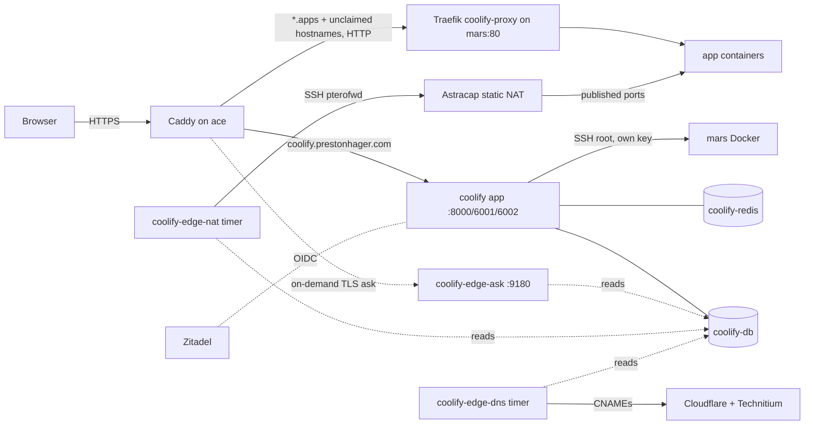

# Coolify on ace

[Coolify](https://coolify.io) is the app hosting panel for class and side projects. The dashboard runs on ace; apps run on **mars**, which Coolify reaches over SSH. crux was a deploy server until 2026-10-20 and has been removed from Coolify.

| | |
|---|---|
| Dashboard | https://coolify.prestonhager.com (LAN, tailnet and WireGuard only; see [Access](#access)) |
| Apps | `https://<name>.apps.prestonhager.com`, or any other `prestonhager.com` name (see [Routing](#routing-traffic-to-apps)) |
| Version | Coolify 4.4.6 (pinned by digest) |
| Deploy server | mars (192.168.5.15), Coolify proxy (Traefik) on :80 |
| Config | `nixos/containers/coolify.nix`, `nixos/containers/coolify-sso.nix`, `nixos/containers/coolify-edge.nix`, `nixos/caddy/coolify.nix`, `nixos/coolify-node.nix` (mars) |
| Secrets | `nixos-secrets/secrets/containers/coolify.yaml`; SMTP password from `nextcloud-environment`; router key `pterodactyl-router-ssh-key`; Cloudflare token `cloudflare-acme-env`; Technitium admin password |

## How it fits together



- **TLS** terminates on ace's Caddy with Cloudflare DNS-01 certificates (the `*.apps` wildcard needs DNS-01). Coolify's proxy on mars only serves HTTP on :80, and mars's `coolify-ingress` chain (`nixos/coolify-node.nix`) drops new connections from private sources other than ace→:80, while app containers cannot reach the LAN ([mars](../poweredge/mars.md)). Traefik trusts `X-Forwarded-*` from ace (`--entrypoints.http.forwardedHeaders.trustedIPs=192.168.5.5/32` in the proxy configuration), so apps see `https`.
- **DNS**: Cloudflare CNAMEs `coolify` and `*.apps` → `ip1.lc1.nm.us.prestonhager.com`; Technitium has the same names → ace for the LAN (`technitium-zones.nix`).
- **Containers** run on the `coolify` Podman network (not a pod), so restarting one of them never strands the others in a dead network namespace.

## Access

`nixos/caddy/coolify.nix` splits `coolify.prestonhager.com` by path:

| Path | Who can reach it | Why |
|---|---|---|
| `/webhooks/*` | anyone | GitHub (App and manual webhooks) must reach it to trigger deploys; Coolify checks the webhook secret |
| `/api/*` | LAN, tailnet, WireGuard, and GitHub-hosted Actions runners | token-authenticated API. Animal Search's deploy workflow runs on GitHub-hosted runners and calls it (see [GitHub Actions access to the API](#github-actions-access-to-the-api)). `githubActionsApi = false` in `nixos/caddy/coolify.nix` makes it LAN-only again |
| `/app/*` (realtime), `/terminal/ws` (web terminal), everything else (dashboard, login, Zitadel callback) | LAN, tailnet, WireGuard | admin surface |

"LAN, tailnet, WireGuard" is the shared `lanOnly` guard in `nixos/caddy/lib.nix` (`192.168.5.0/24`, `100.64.0.0/10` and the tailnet IPv6 range, `192.168.20.0/24`, loopback); everyone else gets 403. Off-site, connect to the tailnet or the VPN first, and make sure the name resolves to ace's LAN address (Technitium) rather than the public IP. Apps (`*.apps.prestonhager.com` and the on-demand catch-all) stay public.

### GitHub Actions access to the API

The GitHub runner ranges are the `actions` list from `https://api.github.com/meta` (about 7,000 IPv4 and IPv6 CIDRs, changed often), so they are fetched rather than written into Nix:

- `coolify-github-actions-ips.service` (on boot, on every switch, and every 6 hours from its timer) downloads the list. It rejects a list with fewer than 100 entries or anything that is not a CIDR, runs `caddy validate` on the generated matcher, then writes `/var/lib/coolify-github-actions/matcher.caddy` (`@github_actions { remote_ip … }`) and reloads Caddy if the list changed. On any failure it keeps the current file, and the unit fails.
- The vhost `import`s that file. On a fresh host, tmpfiles first creates it holding only `192.0.2.0/32` (TEST-NET-1), so Caddy starts and the API stays closed until the first successful fetch.

These are shared GitHub/Azure addresses: any GitHub Actions job, in any repository, connects from them. The allowlist only keeps the rest of the internet away; the API token still does the authorizing, so keep tokens scoped (`deploy`, `read`, `write`, never `root`) and revoke unused ones in **Keys & Tokens**. Self-hosted runners on the LAN already match the LAN rule.

```bash
systemctl start coolify-github-actions-ips    # refresh now
journalctl -u coolify-github-actions-ips -n 5 # "<n> ranges, unchanged|updated"
grep -c remote_ip /var/lib/coolify-github-actions/matcher.caddy
```

Registration is pinned off by `coolify-instance-settings` (a UI toggle is reverted on the next run; Coolify itself also turns it off after creating the first user). Coolify 4.4.6 only lets the generic `oidc` provider create accounts while registration is off; the `zitadel` provider used here does not, so a Zitadel user who has never signed in to Coolify cannot create an account by signing in. See [Signing in and adding users](#signing-in-and-adding-users).

## Routing traffic to apps

Everything an app in Coolify needs from outside (DNS, TLS, proxying, port forwards) is derived from what is configured in Coolify; there is nothing to add in Nix or by hand per app.

**Web (HTTP/HTTPS).** `nixos/caddy/coolify.nix` has three sites for apps:

| Caddy site | Goes to | Certificate |
|---|---|---|
| `*.apps.prestonhager.com` | mars:80 | wildcard (DNS-01) |
| `https://` (catch-all) | mars:80 | issued on demand, per hostname |
| `http://` (catch-all) | 308 redirect to HTTPS | — |

Caddy always prefers the most specific site, so the catch-alls only see hostnames that none of ace's own services claim. Before Caddy issues an on-demand certificate it asks `coolify-edge-ask` (`127.0.0.1:9180/ask?domain=…`), which says yes only when an application, preview or service of the Root Team (`COOLIFY_EDGE_TEAM_IDS`) uses that hostname, it is inside `COOLIFY_EDGE_ZONES` (`prestonhager.com`), **and** it is not reserved:

- `COOLIFY_EDGE_DENY_HOSTS`: every hostname ace's own Caddy serves (generated from `services.caddy.virtualHosts`), and the zone apex;
- `COOLIFY_EDGE_DENY_LABELS`: any name with a sensitive label below the zone, such as `login`, `sso`, `auth`, `admin`, `vault`, `mail`, `www`, `zitadel`, `panel`, `cloud`, `grafana`, `coolify`, `dns`, `wg` or `prometheus` (full list in `coolify-edge.nix`), so `admin.group5.prestonhager.com` is refused too.

Refused names also get no DNS records. The ask endpoint remembers unknown names for 30 seconds and re-reads Coolify's database at most every 5 seconds on a miss, so a flood of random SNI names cannot run a database query per request. Any other name fails the TLS handshake, so stray SNI never reaches Let's Encrypt. Certificates use the same Cloudflare DNS-01 token as everything else, so only names in Cloudflare zones that token can edit work.

To give an app a custom name such as `group5.prestonhager.com`, set the app's domain in Coolify to `http://group5.prestonhager.com` (always `http://`; TLS is ace's job) and deploy. Within a minute `coolify-edge-dns` creates:

- **Cloudflare:** CNAME `group5` → `ip1.lc1.nm.us.prestonhager.com`, DNS only, comment `managed by coolify-edge (nixos-configs)`. It uses the Caddy DNS-01 token (`cloudflare-acme-env`).
- **Technitium (LAN):** CNAME `group5` → `ace.internal.prestonhager.com`. Technitium is authoritative for `prestonhager.com` on the LAN, so without it LAN clients could not resolve the name. `technitium-sync-zones` re-imports the zone when the Nix zone file changes, which drops these records; the job re-adds them within 15 minutes (or run `systemctl start coolify-edge-dns`).

When the domain is removed from Coolify, both records are deleted. Only records the job created are ever deleted (by comment in Cloudflare, by its state file in Technitium). A name that already has other records, such as `grafana`, is left alone and logged as a conflict. `*.apps.prestonhager.com` names are skipped because the wildcard records already cover them. The first HTTPS request to a new name waits a few seconds for the certificate.

**Other ports (TCP/UDP).** `coolify-edge-nat` (timer, every minute) forwards from the WAN every host port that Coolify publishes on mars:

- an application's **Ports Mappings** (`8080:80`, `25565:25565/udp`, `27000-27010:27000-27010`; mappings bound to `127.0.0.1` are skipped), and
- only if `COOLIFY_EDGE_FORWARD_PUBLIC_DATABASES = "1"` (default off): a database with **Make it publicly available** (its public port) or its own port mappings. With the default, a public database is reachable from the LAN only.

Limits: a range wider than `COOLIFY_EDGE_MAX_RANGE` (20) ports is skipped, and if more than `COOLIFY_EDGE_MAX_PORTS` (50) ports would be forwarded in total the job refuses to change the router at all and the unit fails. Every NAT line it adds or removes is logged at warning priority (`journalctl -p warning -u coolify-edge-nat`).

It writes `ip nat inside source static <tcp|udp> 192.168.5.15 <port> interface GigabitEthernet0/0 <port>` on Astracap and removes `192.168.5.15` lines Coolify no longer wants. Lines for other inside addresses (ace's :80/:443, Pterodactyl game ports) are never touched; a port already forwarded elsewhere is reported as a conflict and skipped. Ports in `COOLIFY_EDGE_BLOCKED_PORTS` are never forwarded: SSH, DNS, HTTP(S), DoT and the router's own ports, plus common mail, SMB, NFS, RDP, SNMP and LDAP ports and ace's admin ports (full list in `coolify-edge.nix`). The WAN port equals the host port. Rules live in running-config only (like the Pterodactyl extension's); the timer re-checks the router every 15 minutes while any rule is wanted, so they come back after a router reboot. While no app publishes a port it never logs in to the router.

Docker Compose services (Coolify *Services* and the Docker Compose build pack) are not covered: their `ports:` are not stored in a column Coolify exposes. Publish such ports through an application's Ports Mappings instead.

The NAT job logs in as `pterofwd` with the Pterodactyl port-forward key. That account must be allowed to run `show running-config` and `configure terminal` (see [Astracap](../shared/network-astracap.md#automation-account-pterofwd)).

```bash
journalctl -u coolify-edge-nat -n 20      # what it added/removed, conflicts
journalctl -u coolify-edge-dns -n 20      # CNAMEs added/removed, conflicts, refused names
journalctl -p warning -u 'coolify-edge-*' # only the changes (router/DNS) and refusals
journalctl -u coolify-edge-ask -f         # on-demand TLS decisions
cat /var/lib/coolify-edge/{nat,dns}.json  # last wanted sets
systemctl start coolify-edge-nat coolify-edge-dns   # sync now
```

To see what the job would do without touching the router: `systemctl cat coolify-edge-nat` for the environment, then run its `ExecStart` with `--dry-run`. `… edge-sync.py domains` lists the hostnames the ask endpoint accepts.

## Email

Coolify sends mail (password resets, invitations, deployment and server notifications) through the iCloud+ SMTP account that Nextcloud, Grafana and Zitadel use: `smtp.mail.me.com:587`, STARTTLS, user `prestonhager@icloud.com`, from `Coolify <admin@prestonhager.com>`. `coolify-email-settings.service` (`nixos/containers/coolify/email-settings.php`) writes this into Coolify's instance settings on every boot and switch, with the password taken from `SMTP_PASSWORD` in the `nextcloud-environment` secret, and sets the Root Team's email notifications to use the instance settings. Changing it in the UI is undone on the next run.

Which events mail out is chosen in Coolify → **Notifications** → **Email**; recipients are the team's members. Test with **Send Test Email** on that page.

## Signing in and adding users

Login is through Zitadel (**Sign in with Zitadel** on the login page). Coolify's Zitadel app lives in its own Zitadel project, **Coolify**, which has *Check authorization on authentication* turned on: only users with a Coolify role can sign in at all.

| Zitadel role | Coolify |
|---|---|
| `coolify_admin` | Admin of the Root Team (servers, projects, deployments) |
| `coolify_member` | Member of the Root Team |
| *(none)* | Cannot sign in; removed from the Root Team on the next sync |

To add someone:

1. Create the user in Zitadel (Console → Users → New), or use an existing one. Their email must be verified.
2. Console → Projects → **Coolify** → Authorizations → **New** → pick the user and `coolify_admin` or `coolify_member`.
3. They sign in at https://coolify.prestonhager.com (from the LAN, tailnet or VPN) with **Sign in with Zitadel**. Registration is pinned off, so for a brand-new user turn on **Settings → Configuration → Registration** just before their first login; `coolify-instance-settings` turns it off again on the next boot or switch (or run `systemctl restart coolify-instance-settings` right after).
4. Within 5 minutes `coolify-zitadel-roles.timer` adds them to the Root Team with the matching role (run `systemctl start coolify-zitadel-roles` on ace to do it now).

To remove someone, delete their Coolify authorization in Zitadel. They can no longer sign in, and the next sync removes them from the Root Team. The original owner account (preston@hagerfamily.com, user 0) is never changed by the sync.

**Break-glass login:** the owner can also sign in with email and password. The password is `ROOT_USER_PASSWORD` in `coolify-env`:

```bash
cd ~/nixos-secrets   # on a machine with the root age key
sops -d --extract '["coolify-env"]' secrets/containers/coolify.yaml | grep ROOT_USER_PASSWORD
```

Public registration is off (Settings → Configuration) and pinned off by `coolify-instance-settings`. New accounts only come from Zitadel, during a short window with registration on (step 3 above); the dashboard is not reachable from the internet in any case.

## Hosting the CS371 group 5 project

Repository: https://github.com/NMSU-CS-CS371/software-development-semester-project-group-5 (private).

**Current setup (Animal Search, 2026-10-25):** Coolify project **Animal Search**, two Docker Image apps on mars that run `ghcr.io/nmsu-cs-cs371/software-development-semester-project-group-5`. The repo's `deploy-coolify.yml` builds and pushes that image on GitHub-hosted runners, pins the app to the commit's tag through the API and triggers the deploy. mars's server **Wildcard Domain** is `http://apps.prestonhager.com`, so new apps default to `http://<uuid>.apps.prestonhager.com`.

| Environment | App uuid (`COOLIFY_APP_UUID`) | URL | Image tag |
|---|---|---|---|
| staging | `til4tnx6t6nf05gia9lhydwn` | https://til4tnx6t6nf05gia9lhydwn.apps.prestonhager.com | `staging`, then the commit SHA |
| production | `v50rlefzhzwuofnh9aj89bfm` | https://v50rlefzhzwuofnh9aj89bfm.apps.prestonhager.com | `production`, then the commit SHA |

Both expose port 4321 (no port mappings) with a health check on `/`. The workflow's GitHub environments need `COOLIFY_URL=https://coolify.prestonhager.com`, `COOLIFY_APP_UUID` and `APP_URL` as variables, and `COOLIFY_TOKEN` as a secret. mars pulls the image with its `ghcr.io` login in `/root/.docker/config.json`. This is separate from the Podman deployment at `animal-search.prestonhager.com` ([Animal Search on ace](animal-search-ace.md)).

The steps below are the general procedure.

### 1. Give Coolify access to the repository

The repository is private, so Coolify needs credentials. Pick one:

- **GitHub App (recommended; gives push-to-deploy):** Coolify → **Sources** → **+ Add** → **GitHub App**. Name it e.g. `coolify-ace`, keep the webhook endpoint `https://coolify.prestonhager.com`, and choose **Register now**. The app can be owned by any account or organization, not only the one that owns the repository. A GitHub App is installable only on its owner's account until it is made public, though: if you register it on your own account (or another org), open GitHub → the app's settings → **Advanced** → **Make public**, then **Install** it on `NMSU-CS-CS371` and select only the group 5 repository. An org owner has to approve the install if you are not one.
- **Deploy key (no org approval needed, manual or webhook deploys):** Coolify → **Keys & Tokens** → **Private Keys** → **+ Add** → **Generate new ED25519 key**, name it `group5-deploy`. Copy the public key into the repository: GitHub → repo → Settings → **Deploy keys** → Add (read-only). Requires admin on the repository.

GitHub Actions runners are separate from this: a self-hosted runner serves only the repository or organization it is registered to, whatever owns the Coolify app. A workflow can trigger a deploy through Coolify's API (Keys & Tokens → API tokens, then `GET https://coolify.prestonhager.com/api/v1/deploy?uuid=<app uuid>` with `Authorization: Bearer <token>`) or the application's deploy webhook. The API answers the LAN/tailnet and GitHub-hosted Actions runners (see [GitHub Actions access to the API](#github-actions-access-to-the-api)), so both self-hosted and GitHub-hosted runners can call it.

### 2. Create the application

1. Coolify → **Projects** → **+ Add** → name `cs371-group5`; open the `production` environment.
2. **+ New** → **Private Repository (with GitHub App)** or **Private Repository (with Deploy Key)**.
3. Select the repository and branch (`main`), then the build pack:
   - **Dockerfile** if the repo has one at the root (or set *Base Directory* / *Dockerfile Location*),
   - **Docker Compose** for a `docker-compose.yml` with several services,
   - **Nixpacks** to auto-detect Node/Python/etc. without a Dockerfile,
   - **Docker Image** to run an image a CI workflow already pushed (e.g. to GHCR).
4. **Server**: `mars`, destination: the default `coolify` network.
5. **Ports Exposes**: the port the app listens on inside the container (e.g. `3000`).
6. **Domains**: `http://group5.apps.prestonhager.com`

   Use `http://`, not `https://`. TLS is handled by Caddy on ace; Coolify's proxy on mars has no :443 and requesting a certificate there would fail. The public URL is still `https://group5.apps.prestonhager.com`.
7. **Environment Variables**: add secrets here (stored encrypted in Coolify's database). Mark build-time variables *Build Variable* if the build needs them.
8. **Health Check** (Advanced): set a path such as `/` or `/health` so Coolify only switches traffic to a healthy new container.
9. **Deploy**. Watch the build log; the first build pulls base images on mars.

Databases the app needs (Postgres, Redis, …) can be added in the same environment with **+ New** → **Database** on `mars`; reference them from the app by the internal hostname Coolify shows.

### 3. Automatic deploys

- With the GitHub App, enable **Auto Deploy** on the application; pushes to `main` deploy automatically.
- With a deploy key, copy the application's **Webhook** URL (Webhooks tab) into GitHub → repo → Settings → Webhooks (content type `application/json`, the secret Coolify shows), or deploy manually.
- From GitHub Actions, call the deploy API above as the last job step.
- **Preview deployments** (optional): set the preview URL template to `{{pr_id}}-group5.apps.prestonhager.com`. Keep it one label under `apps`: the wildcard certificate covers `*.apps.prestonhager.com` only, not `pr-1.group5.apps…`.

### 4. Monitoring

Add the app's public URL to `coolifyAppTargets` in `nixos/monitoring/prometheus-config.nix` and rebuild ace:

```nix
coolifyAppTargets = [
  "https://group5.apps.prestonhager.com/"
];
```

It then appears in the **Coolify** Grafana dashboard (*Deployed apps*), and the *Ace service probe failed* alert pages if it is down for 5 minutes.

## Monitoring and alerts

| What | Where |
|---|---|
| Dashboard health (`/api/health` through Caddy) | essential blackbox probe; Grafana **Coolify** dashboard |
| Containers (`podman-coolify`, `-db`, `-redis`) | alert *Coolify container down* (5 min) |
| App proxy on mars:80 | essential TCP probe (`blackbox-tcp-lan-hosts`, `service="coolify-proxy"`); Coolify and Network Topology dashboards |
| Deployed apps | `coolifyAppTargets` (see above) |

## Operations

**Upgrade Coolify:** check `https://cdn.coollabs.io/coolify/versions.json`, pull the new image on ace (`podman pull ghcr.io/coollabsio/coolify:<version>`), put its digest in `coolifyImage` in `coolify.nix`, rebuild. Do not use Coolify's built-in self-update; it expects Docker and upstream's compose layout.

**Logs:** `podman logs coolify`, `journalctl -u coolify-zitadel-roles`, `journalctl -u coolify-email-settings`, `journalctl -u coolify-edge-ask -u coolify-edge-nat`; proxy on mars: `docker logs coolify-proxy`.

**Back up:** `/stor/coolify/postgres` (Coolify's database) and `APP_KEY` in `coolify-env`. APP_KEY encrypts stored server keys, SMTP settings and environment variables; without it a database restore cannot decrypt them.

**Servers:** Coolify lists `localhost` (id 0, force-disabled by `coolify-instance-settings`; Coolify needs it to exist) and `mars` (id 2). crux (id 1) was deleted on 2026-10-20 together with its proxy containers and `/data/coolify` on crux.

**Why mars was registered by hand:** Coolify's server validation only accepts its list of distributions and rejects `ID=nixos`. Connection, Docker, Compose and `git`/`curl`/`jq` were validated; the server was then marked usable directly. Docker on mars is managed by NixOS (`virtualisation.docker`, with `liveRestore`), so Coolify's own Docker installer is never needed. To add another node, enable the same `nixos/coolify-node.nix` on it, register it the same way, and add its IP to `COOLIFY_EDGE_NODES` in `coolify-edge.nix`. ace's Caddy sends all app traffic to mars, so apps on a second node also need their own upstream in `nixos/caddy/coolify.nix`.
