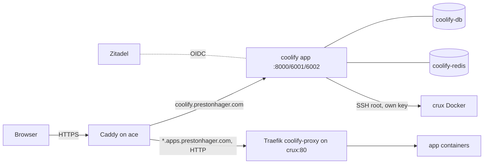

# Coolify on ace

[Coolify](https://coolify.io) is the app hosting panel for class and side projects. The dashboard runs on ace; apps run on deploy servers that Coolify reaches over SSH (crux today).

| | |
|---|---|
| Dashboard | https://coolify.prestonhager.com |
| Apps | `https://<name>.apps.prestonhager.com` |
| Version | Coolify 4.4.6 (pinned by digest) |
| Deploy server | crux (192.168.5.6), Coolify proxy (Traefik) on :80 |
| Config | `nixos/containers/coolify.nix`, `nixos/containers/coolify-sso.nix`, `nixos/caddy/coolify.nix`, `nixos/coolify-node.nix` (crux) |
| Secrets | `nixos-secrets/secrets/containers/coolify.yaml` |

## How it fits together



- **TLS** for both names terminates on ace's Caddy with Cloudflare DNS-01 certificates (the `*.apps` wildcard needs DNS-01). Wings owns crux:443, so Coolify's proxy only serves HTTP on :80. A `DOCKER-USER` rule on crux drops :80 from anything but ace.
- **DNS**: Cloudflare CNAMEs `coolify` and `*.apps` → `ip1.lc1.nm.us.prestonhager.com`; Technitium has the same names → ace for the LAN (`technitium-zones.nix`).
- **Containers** run on the `coolify` Podman network (not a pod), so restarting one of them never strands the others in a dead network namespace.

## Signing in and adding users

Login is through Zitadel (**Sign in with Zitadel** on the login page). Coolify's Zitadel app lives in its own Zitadel project, **Coolify**, which has *Check authorization on authentication* turned on: only users with a Coolify role can sign in at all.

| Zitadel role | Coolify |
|---|---|
| `coolify_admin` | Admin of the Root Team (servers, projects, deployments) |
| `coolify_member` | Member of the Root Team |
| *(none)* | Cannot sign in; removed from the Root Team on the next sync |

To add someone:

1. Create the user in Zitadel (Console → Users → New), or use an existing one. Their email must be verified.
2. Console → Projects → **Coolify** → Authorizations → **New** → pick the user and `coolify_admin` or `coolify_member`.
3. They sign in at https://coolify.prestonhager.com with **Sign in with Zitadel**. Coolify creates their account on first login.
4. Within 5 minutes `coolify-zitadel-roles.timer` adds them to the Root Team with the matching role (run `systemctl start coolify-zitadel-roles` on ace to do it now).

To remove someone, delete their Coolify authorization in Zitadel. They can no longer sign in, and the next sync removes them from the Root Team. The original owner account (preston@hagerfamily.com, user 0) is never changed by the sync.

**Break-glass login:** the owner can also sign in with email and password. The password is `ROOT_USER_PASSWORD` in `coolify-env`:

```bash
cd ~/nixos-secrets   # on a machine with the root age key
sops -d --extract '["coolify-env"]' secrets/containers/coolify.yaml | grep ROOT_USER_PASSWORD
```

Public registration is off (Settings → Configuration). New accounts only come from Zitadel.

## Hosting the CS371 group 5 project

Repository: https://github.com/NMSU-CS-CS371/software-development-semester-project-group-5 (private).

### 1. Give Coolify access to the repository

The repository is private, so Coolify needs credentials. Pick one:

- **GitHub App (recommended; gives push-to-deploy):** Coolify → **Sources** → **+ Add** → **GitHub App**. Name it e.g. `coolify-ace`, keep the webhook endpoint `https://coolify.prestonhager.com`, and choose **Register now**. GitHub opens the app form; register it on your account (or on the NMSU-CS-CS371 org if you are an org owner), then **Install** it on the org and select only the group 5 repository. An org owner has to approve the install if you are not one.
- **Deploy key (no org approval needed, manual or webhook deploys):** Coolify → **Keys & Tokens** → **Private Keys** → **+ Add** → **Generate new ED25519 key**, name it `group5-deploy`. Copy the public key into the repository: GitHub → repo → Settings → **Deploy keys** → Add (read-only). Requires admin on the repository.

### 2. Create the application

1. Coolify → **Projects** → **+ Add** → name `cs371-group5`; open the `production` environment.
2. **+ New** → **Private Repository (with GitHub App)** or **Private Repository (with Deploy Key)**.
3. Select the repository and branch (`main`), then the build pack:
   - **Dockerfile** if the repo has one at the root (or set *Base Directory* / *Dockerfile Location*),
   - **Docker Compose** for a `docker-compose.yml` with several services,
   - **Nixpacks** to auto-detect Node/Python/etc. without a Dockerfile.
4. **Server**: `crux`, destination: the default `coolify` network.
5. **Ports Exposes**: the port the app listens on inside the container (e.g. `3000`).
6. **Domains**: `http://group5.apps.prestonhager.com`

   Use `http://`, not `https://`. TLS is handled by Caddy on ace; Coolify's proxy on crux has no :443 and requesting a certificate there would fail. The public URL is still `https://group5.apps.prestonhager.com`.
7. **Environment Variables**: add secrets here (stored encrypted in Coolify's database). Mark build-time variables *Build Variable* if the build needs them.
8. **Health Check** (Advanced): set a path such as `/` or `/health` so Coolify only switches traffic to a healthy new container.
9. **Deploy**. Watch the build log; the first build pulls base images on crux.

Databases the app needs (Postgres, Redis, …) can be added in the same environment with **+ New** → **Database** on `crux`; reference them from the app by the internal hostname Coolify shows.

### 3. Automatic deploys

- With the GitHub App, enable **Auto Deploy** on the application; pushes to `main` deploy automatically.
- With a deploy key, copy the application's **Webhook** URL (Webhooks tab) into GitHub → repo → Settings → Webhooks (content type `application/json`, the secret Coolify shows), or deploy manually.
- **Preview deployments** (optional): set the preview URL template to `{{pr_id}}-group5.apps.prestonhager.com`. Keep it one label under `apps`: the wildcard certificate covers `*.apps.prestonhager.com` only, not `pr-1.group5.apps…`.

### 4. Monitoring

Add the app's public URL to `coolifyAppTargets` in `nixos/monitoring/prometheus-config.nix` and rebuild ace:

```nix
coolifyAppTargets = [
  "https://group5.apps.prestonhager.com/"
];
```

It then appears in the **Coolify** Grafana dashboard (*Deployed apps*), and the *Ace service probe failed* alert pages if it is down for 5 minutes.

## Monitoring and alerts

| What | Where |
|---|---|
| Dashboard health (`/api/health` through Caddy) | essential blackbox probe; Grafana **Coolify** dashboard |
| Containers (`podman-coolify`, `-db`, `-redis`) | alert *Coolify container down* (5 min) |
| App proxy on crux:80 | essential TCP probe; Coolify and Network Topology dashboards |
| Deployed apps | `coolifyAppTargets` (see above) |

## Operations

**Upgrade Coolify:** check `https://cdn.coollabs.io/coolify/versions.json`, pull the new image on ace (`podman pull ghcr.io/coollabsio/coolify:<version>`), put its digest in `coolifyImage` in `coolify.nix`, rebuild. Do not use Coolify's built-in self-update; it expects Docker and upstream's compose layout.

**Logs:** `podman logs coolify`, `journalctl -u coolify-zitadel-roles`, proxy on crux: `docker logs coolify-proxy`.

**Back up:** `/stor/coolify/postgres` (Coolify's database) and `APP_KEY` in `coolify-env`. APP_KEY encrypts stored server keys and environment variables; without it a database restore cannot decrypt them.

**Why crux was registered by hand:** Coolify's server validation only accepts its list of distributions and rejects `ID=nixos`. Connection, Docker, Compose and `git`/`curl`/`jq` were validated; the server was then marked usable directly. Docker on crux is managed by NixOS (`virtualisation.docker`, with `liveRestore`), so Coolify's own Docker installer is never needed. To add another node, enable the same `nixos/coolify-node.nix` on it and register it the same way.

