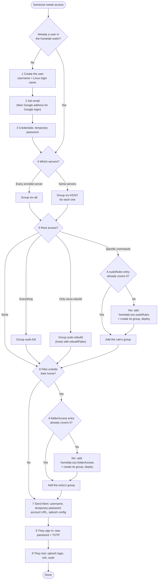

# Adding a user and granting access

Use this page to give someone server access through Keycloak. The admin console is at https://keycloak.prestonhager.com/admin; work in the **homelab** realm, not `master`. How the pieces fit together is in `docs/sso-login.md`; the Keycloak service itself is in `docs/keycloak-ace.md`.

Most access is a **Keycloak group**: add or remove a group and the change is live within 5 minutes, no deploy. Only access that needs a new rule (a new sudo command list, a folder ACL) needs a Nix change and a deploy.

## The flow



## Steps

### 1. Create the user

Users → **Add user**.

- **Username:** the Linux login name, which can't be changed later. Lowercase letters, digits and `-` only, starting with a letter. It must not be a local account name (`root`, `phadmin`, `nginx`, `docker`, ...): a local account always wins, and opkssh refuses to log in to local accounts.
- **First and last name:** fill them in; Keycloak asks at first login otherwise.
- Leave **Required user actions** empty. Step 3 adds the password change, and TOTP setup is forced at first login.
- Leave **Groups** empty for now (step 4 onward).

### 2. Set the email

Set **Email** on the user's Details tab and switch **Email verified** on.

**Sign in with Google** links a Google account to the Keycloak user with exactly this email. A Google account whose email no user has is refused, never created. So:

- For Google login, use the address of their Google account.
- Never give two users the same email (Keycloak refuses that anyway).
- Changing the email later does not move an existing Google link; see "Google login" below.

### 3. Temporary password

Credentials tab → **Set password**, with **Temporary** on. They must replace it at first login. Send it to them over a private channel (Vaultwarden Send, Signal), never in the same message as the username.

### 4. Which servers

Groups tab → **Join group**.

| They need | Group |
|---|---|
| Every enrolled server | `srv-all` |
| One server | `srv-<host>`, for example `srv-mars` or `srv-crux` |
| Several servers | one `srv-<host>` group per server |

The enrolled servers are mars, crux, elara, nova and zenith; ace is not enrolled yet. A host added later needs its `srv-<host>` group created (Groups → Create group) before anyone can be added to it.

### 5. Root access

| They need | What to do |
|---|---|
| No root | Nothing |
| Full root | Group `sudo-full` |
| Only `nixos-rebuild` of the host's own flake | Group `sudo-rebuild`. It only does anything on hosts that set `homelab.sso.rebuildFlake`, which none do today, since the nodes are deployed from ace |
| Specific commands (restart a service, read a unit's logs) | Group of the matching `homelab.sso.sudoRules` entry. If none exists, add one in Nix (below) |

Adding a sudo rule (needs a deploy):

1. Pick a group name that describes the job, such as `wings-ops`, and create it in Keycloak (Groups → Create group). Don't reuse a local group name such as `wheel`, `docker` or `users`.
2. Add the rule to the host's config (for the Wings nodes, `hosts/pterodactyl-nodes/default.nix`):

   ```nix
   homelab.sso.sudoRules.wings = {
     groups = [ "wings-ops" ];
     commands = [
       "/run/current-system/sw/bin/systemctl restart wings.service"
       "/run/current-system/sw/bin/journalctl -u wings.service"
     ];
   };
   ```

3. Deploy the host, then add the user to the group.

Use full paths and exact arguments. Never list editors, pagers, shells, interpreters or file tools (`vim`, `less`, `find`, `tar`, `cp`, `rsync`, `tee`, `systemctl edit`, ...): each of them can start a root shell, so the rule would be full root in disguise. For files, use step 6 instead.

### 6. Files outside their home

Folder access is a POSIX ACL for a group, applied by `sso-folder-acls.service`. It is not sudo, so it gives no other root rights.

1. Create a group in Keycloak, such as `game-backups`.
2. Add the entry to the host's config and deploy:

   ```nix
   homelab.sso.folderAccess = [
     { path = "/var/lib/pterodactyl/backups"; group = "game-backups"; access = "read"; }   # or "write"
   ];
   ```

3. Add the user to the group. Group changes in Keycloak need no further deploy; the ACL already names the group.

Services that `chmod` their own files can narrow an ACL. On the Wings nodes, `pterodactyl-config-perms` caps access under `/var/lib/pterodactyl` at read-only.

### 7. Hand off

Send them:

- their username, and the temporary password (separately);
- https://keycloak.prestonhager.com/realms/homelab/account for first sign-in;
- the opkssh client config from `docs/sso-login.md` ("Logging in");
- a reminder that Keycloak is reachable only from the LAN, Tailscale or the WireGuard VPN, so they need the VPN set up first (wg-portal).

### 8. First sign-in (them)

At the account page they sign in with the temporary password (or **Google**, if step 2 used their Google address), then set a new password and TOTP. The account console should then load. If it shows "Something went wrong", see the troubleshooting table in `docs/keycloak-ace.md`.

### 9. Test (them, with you)

```bash
opkssh login                    # browser: Keycloak or Google, then TOTP
ssh <username>@<host>           # e.g. 192.168.5.15 for mars
id                              # srv-*/sudo-* groups listed
sudo -v                         # only with a sudo group: device-code prompt, approve in the browser
```

If something fails, check the troubleshooting section of `docs/sso-login.md` on that host. `sssctl user-checks <username> -s sshd` shows the access decision.

## Changing or removing access

| Change | What to do | Takes effect |
|---|---|---|
| Take away a server or sudo | Remove the group | Next login or sudo, within 5 minutes (SSSD cache) |
| Lock someone out now | Users → the user → **Enabled** off, then Sessions → **Sign out** | Next login or sudo. An `opkssh` key already issued still passes the signature check for up to 12 h, but SSSD refuses the disabled user |
| Remove someone | Disable first; delete once nothing on the servers still needs their uid. Their home directories stay on each server until removed by hand | As above |
| Remove a Google link | Users → the user → **Identity provider links** → Unlink | Next Google login: refused unless the email still matches, in which case it links again |

On a server, `sss_cache -E` drops the cache so a change applies immediately.

## Google login

Users click **Google** on the Keycloak sign-in page. Keycloak then:

1. looks for a homelab user with the same email as the Google account; none found means "does not exist. Please contact your administrator", and **no account is created**;
2. links the Google account to that user (first time only);
3. asks for the user's **Keycloak TOTP**, so a stolen Google account alone does not get anyone in.

Setup and secret rotation are in `docs/keycloak-ace.md` ("Sign in with Google").

## Not covered by Keycloak yet

The web apps (Grafana, Nextcloud, Jellyfin, Pterodactyl panel, Matrix, Vaultwarden) still sign in through **Zitadel**. Access to those is granted there, as described in `docs/zitadel-ace.md`, until each app moves to Keycloak.
