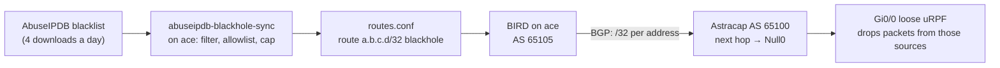

# AbuseIPDB blackhole on Astracap

Astracap drops traffic from IPv4 addresses that [AbuseIPDB](https://www.abuseipdb.com/) is highly confident are malicious (score ≥ 95%). LAN clients can't reach those addresses either.

Implementation: `nixos/security/abuseipdb-blackhole.nix`, `nixos/security/abuseipdb-blackhole-sync.py`, options under `homelab.security.abuseipdbBlackhole` (enabled in `hosts/ace/default.nix`).

**Status:** the ace side is deployed. It announces nothing until two owner steps are done: the [API key](#1-abuseipdb-api-key) and the [router configuration](#2-router-configuration).

## How it works



1. `abuseipdb-blackhole-sync.timer` runs at 01:15, 07:15, 13:15 and 19:15 (±20 min). It downloads the blacklist at most every 5 hours: a free account may download it 5 times a day.
2. It keeps IPv4 global-unicast addresses with a score of at least `minConfidence` (95). It drops anything in the allowlist, caps the list at `maxPrefixes` (10,000; highest score and most recently reported first), and writes one `route …/32 blackhole;` per address.
3. The full BIRD config is checked before BIRD loads the new list (`birdc configure`). If BIRD rejects it, the previous list is restored.
4. BIRD announces each address to Astracap as a /32 over eBGP. ace connects; the router side is passive.
5. Astracap accepts only /32s that are not private or special-use, and rewrites their next hop to `192.0.2.1`, which is routed to `Null0`. Outbound traffic to those addresses is dropped. Loose unicast RPF (`allow-default`) on the WAN interface drops inbound packets *from* them, before NAT.

**Why BGP instead of an ACL.**

- The 2911 runs IOS 15.7 with the IP Base license only. It checks an interface ACL one entry at a time, so 10,000 entries on the WAN would load the CPU for every packet.
- A static route per address would need 10,000 config lines (~600 KB), more than the router's 256 KB NVRAM, so `write memory` would fail.
- BGP-learned routes live in the routing table (a CEF lookup per packet) and never in the config. Updates are incremental.

**Fail-open.** If ace, BIRD or the session goes down, the router withdraws the routes and blocks nothing; it does not drop other traffic. If no fresh list has been downloaded for 48 hours, the sync withdraws everything, because AbuseIPDB scores decay and stale entries block addresses that are no longer bad.

**Never blocked:** private, CGNAT/tailnet, loopback, link-local and multicast ranges; our WAN address; the public resolvers (1.1.1.1, 1.0.0.1, 8.8.8.8, 8.8.4.4, Quad9); Cloudflare's ranges; GitHub's published ranges (webhooks, Actions runners, API, git, packages). The Cloudflare and GitHub ranges are refreshed with every download. Add more with `homelab.security.abuseipdbBlackhole.allowlist`. The router repeats the private/special-use exclusion in its own prefix-list.

### The 95% threshold and AbuseIPDB plans

The blacklist's `confidenceMinimum` setting is a **subscriber feature**. A free (Standard) account always gets the **100%** list: up to 10,000 addresses, 5 downloads a day. Those are all above 95%, so a free account blocks a subset of what was asked for. To include 95–99%, use a paid plan (Basic: 100,000 addresses, 100 downloads a day). Nothing else changes; the sync already requests `confidenceMinimum=95`. Raise `maxPrefixes`, and the router's `maximum-prefix` below, only together and with care: each route uses router memory.

## Owner steps

### 1. AbuseIPDB API key

1. Create an account at <https://www.abuseipdb.com/register>, then go to **Account → API → Create Key**.
2. In nix-secrets:

   ```bash
   sops secrets/hosts/ace/abuseipdb.yaml
   # abuseipdb-api-key: <the key>
   ```

   The `secrets/hosts/ace/` creation rule encrypts it for ace. Commit and push nix-secrets.
3. In `hosts/ace/default.nix` set `homelab.security.abuseipdbBlackhole.apiKeyConfigured = true`, then:

   ```bash
   cd /etc/nixos && nix flake update nix-secrets && nixos-rebuild switch --flake .#ace
   systemctl start abuseipdb-blackhole-sync
   journalctl -u abuseipdb-blackhole-sync -n 5   # "list fetched: … N to announce"
   ```

### 2. Router configuration

Needs `enable` on Astracap (ace's `pterofwd` account lands at privilege 1, and nothing here needs it). Paste:

```text
configure terminal
 ! Blackholed addresses get this next hop, which goes nowhere.
 ip route 192.0.2.1 255.255.255.255 Null0 name ABUSEIPDB-BLACKHOLE
 !
 ! Accept only /32 host routes that are not private or special-use.
 ip prefix-list ABUSEIPDB-HOSTS seq 10 deny 0.0.0.0/8 le 32
 ip prefix-list ABUSEIPDB-HOSTS seq 20 deny 10.0.0.0/8 le 32
 ip prefix-list ABUSEIPDB-HOSTS seq 30 deny 100.64.0.0/10 le 32
 ip prefix-list ABUSEIPDB-HOSTS seq 40 deny 127.0.0.0/8 le 32
 ip prefix-list ABUSEIPDB-HOSTS seq 50 deny 169.254.0.0/16 le 32
 ip prefix-list ABUSEIPDB-HOSTS seq 60 deny 172.16.0.0/12 le 32
 ip prefix-list ABUSEIPDB-HOSTS seq 70 deny 192.168.0.0/16 le 32
 ip prefix-list ABUSEIPDB-HOSTS seq 80 deny 224.0.0.0/3 le 32
 ip prefix-list ABUSEIPDB-HOSTS seq 1000 permit 0.0.0.0/0 ge 32
 !
 route-map ABUSEIPDB-IN permit 10
  match ip address prefix-list ABUSEIPDB-HOSTS
  set ip next-hop 192.0.2.1
 route-map ABUSEIPDB-IN deny 20
 route-map DENY-ALL deny 10
 !
 router bgp 65100
  bgp router-id 192.168.5.1
  bgp log-neighbor-changes
  neighbor 192.168.5.5 remote-as 65105
  neighbor 192.168.5.5 description ace AbuseIPDB blackhole (BIRD)
  neighbor 192.168.5.5 transport connection-mode passive
  neighbor 192.168.5.5 route-map ABUSEIPDB-IN in
  neighbor 192.168.5.5 route-map DENY-ALL out
  ! More than this and the session drops (fail-open), rather than filling memory.
  neighbor 192.168.5.5 maximum-prefix 12000
 !
 ! Drop packets whose source is routed to Null0. allow-default: every other
 ! internet source matches only the default route and must still pass.
 interface GigabitEthernet0/0
  ip verify unicast source reachable-via any allow-default
end
write memory
```

Only these lines are saved to NVRAM; the routes themselves are learned at runtime. Then set `homelab.security.abuseipdbBlackhole.routerConfigured = true` and rebuild ace, which turns on the "BGP session down" alert.

**Verify:**

```text
show ip bgp summary                                  ! 192.168.5.5 ... State/PfxRcd = a number
show ip route <a listed address>                     ! via 192.0.2.1, then Null0
show ip interface GigabitEthernet0/0 | include verify
show ip traffic | include RPF                        ! "unicast RPF" drop counter rising
```

On ace:

```bash
birdc show protocols all astracap     # Established; "Routes: … exported"
cat /var/lib/node-exporter-textfile/abuseipdb_blackhole.prom
```

**Undo** (on the router): `router bgp 65100` → `no neighbor 192.168.5.5`, or remove BGP entirely with `no router bgp 65100`. Then `interface GigabitEthernet0/0` → `no ip verify unicast source reachable-via any allow-default`, and `write memory`. On ace, set `enable = false` and rebuild.

## Operations

| Task | Command |
|---|---|
| Run a sync now | `systemctl start abuseipdb-blackhole-sync` (a download counts against the 5 a day; within 5 h of the last one it reuses the cached list) |
| Force a download | `systemctl start abuseipdb-blackhole-sync` after deleting `/var/lib/abuseipdb-blackhole/blacklist.json`, or run the script with `--force` |
| Preview without changes | `ABUSEIPDB_KEY_FILE=/run/secrets/abuseipdb-api-key python3 -I nixos/security/abuseipdb-blackhole-sync.py --dry-run` |
| Is an address blocked? | `grep -x 'route 1.2.3.4/32 blackhole;' /var/lib/abuseipdb-blackhole/routes.conf` |
| Unblock one address | add it to `allowlist` and rebuild; the next sync withdraws it |

**Metrics** (`/var/lib/node-exporter-textfile/abuseipdb_blackhole*.prom`):

- `homelab_abuseipdb_configured`, `homelab_abuseipdb_sync_success{status}`;
- `homelab_abuseipdb_announced`, `homelab_abuseipdb_capped`, `homelab_abuseipdb_skipped{reason}`;
- `homelab_abuseipdb_last_run_timestamp_seconds`, `homelab_abuseipdb_list_generated_timestamp_seconds`;
- `homelab_abuseipdb_bgp_established{router_expected}`.

**Alerts** (Grafana, Security folder):

- **AbuseIPDB blocklist not updating:** the key is configured and the sync hasn't run in 12 h, or its last run failed.
- **AbuseIPDB blackhole BGP session down:** `routerConfigured` is true and there has been no session for 15 min.

**Interaction with the Suricata alert.** Blackholed sources are dropped at the router, so they no longer reach ace or show up in Suricata. Expect fewer Suricata scanner alerts once this is live.
